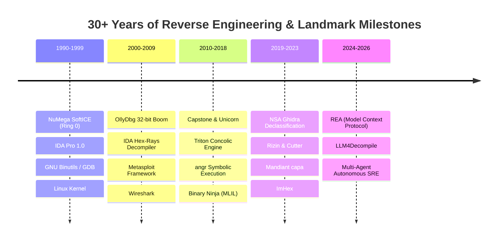

# ⚡ The Chronicle of Reverse Engineering & Landmark Repositories

<div align="center">

[](https://hammadshakeelai.github.io/reverse-engineering-chronicle/)
[](./data/timeline.json)
[](./LICENSE)
[](./prompts/UPDATE_PIPELINE_PROMPT.md)

**An interactive visual genealogy and research knowledge base chronicling over 30 years of disassemblers, decompilers, binary analysis frameworks, and legendary software repositories.**

*From Ring 0 SoftICE and IDA Pro in the 1990s, to the historic declassification of NSA's Ghidra in 2019, up to today's autonomous AI Model Context Protocol (MCP) reverse engineering agents.*

</div>

---

## 🌐 Interactive Web Experience (GitHub Pages)

The repository includes a standalone, zero-dependency, motion-rich cybernetic interactive timeline application designed to be hosted directly on **GitHub Pages**:

- **Real-Time Chronological Navigation**: Toggle between Newest (AI Frontier & NSA Ghidra on top) down through 30+ years of software history.
- **Deep Architecture Modals**: Click into any tool to view its intermediate language (P-Code, Microcode, MLIL), control-flow graph algorithms, and historical impact.
- **Synthesized Cyber Audio FX**: Native Web Audio API sound synthesis without loading external audio assets.
- **Live Search & Filter**: Instant filtering across paradigms (AI Reverse Engineering, Decompilers, Debuggers, Symbolic Execution).
- **Interactive Decompiler Matrix**: Side-by-side comparison of NSA Ghidra, Hex-Rays / IDA Pro, Rizin/Cutter, Binary Ninja, and REA MCP.

---

## 🏛️ Chronological Eras Charted



---

## 📂 Repository Structure

```text
├── .github/
│   └── workflows/
│       ├── deploy.yml            # Automated GitHub Pages CI/CD deployment
│       └── weekly-pulse.yml      # Automated weekly audit & cron issue trigger
├── data/
│   └── timeline.json             # Structured JSON knowledge base (35+ landmark repos)
├── docs/
│   ├── DECOMPILER_EVOLUTION.md   # 30-year technical analysis of decompilation theory
│   ├── NSA_GHIDRA_DEEP_DIVE.md   # NSA Ghidra architecture, Sleigh & P-Code deep dive
│   └── AI_REVERSE_ENGINEERING_FRONTIER.md # LLMs, MCP servers, and autonomous reversing
├── prompts/
│   ├── UPDATE_PIPELINE_PROMPT.md # Autonomous prompt for weekly trending discovery
│   ├── SUBAGENT_RESEARCH_ORCHESTRATOR.md # Swarm orchestrator for subagent research
│   └── DECOMPILER_BENCHMARK_PROMPT.md    # Standardized 5-pillar decompiler rubric
├── index.html                    # Cyber-futuristic interactive web application
└── README.md                     # Knowledge base overview & quick start
```

---

## 🚀 Instant Local Preview

Since the interactive timeline is built as a modern static web application with Tailwind CSS and ES modules, you can run it instantly using any local HTTP server:

```bash
# Using Python
python -m http.server 8000

# Using Node.js
npx serve .

# Or simply open index.html directly in any modern browser!
```

Open `http://localhost:8000` in your web browser.

---

## 🤖 Autonomous Update Pipeline & AI Prompts

This repository is designed to be self-maintaining over future weeks and years. It provides tailored prompts to dispatch AI agents and subagents:

1. **[Master Update Pipeline Prompt](prompts/UPDATE_PIPELINE_PROMPT.md)**: Feed to Claude Code, Antigravity, or Copilot Workspace to scan GitHub trending, validate repository criteria, and format the JSON delta.
2. **[Subagent Research Swarm](prompts/SUBAGENT_RESEARCH_ORCHESTRATOR.md)**: Deploys 4 parallel subagents across the 1990s, 2000s, 2010s, and 2020s to pull historical context from the Internet Archive and conference papers.
3. **[Decompiler Benchmark Rubric](prompts/DECOMPILER_BENCHMARK_PROMPT.md)**: Scores any incoming decompiler out of 50 points across IR fidelity, CFG structuring, type recovery, multi-arch support, and AI interoperability.

---

## 🚢 Enabling GitHub Pages (One-Click)

1. Push this repository to your GitHub account:
   ```bash
   git add .
   git commit -m "feat: initialize reverse engineering chronicle knowledge base"
   git remote add origin https://github.com/<YOUR_USERNAME>/<YOUR_REPO>.git
   git push -u origin master
   ```
2. In your GitHub repository:
   - Navigate to **Settings** → **Pages**.
   - Under **Build and deployment** > **Source**, select **GitHub Actions**.
3. The `.github/workflows/deploy.yml` action will automatically build and publish your site to `https://<YOUR_USERNAME>.github.io/<YOUR_REPO>/`!

---

## 📜 Research Papers & Citations
- **Ghidra**: *National Security Agency Research Directorate*, RSA Conference 2019.
- **Decompilation Theory**: Cifuentes, C. *Reverse Compilation Techniques*, Queensland University of Technology, 1994.
- **LLM4Decompile**: Tan, N. et al. *Reverse Engineering with Large Language Models*, arXiv:2403.05286, 2024.
- **Model Context Protocol**: Anthropic PBC, *Model Context Protocol Specification*, 2024–2025.

---

## 📄 License
This project is open-source under the [MIT License](LICENSE).
All historical trademarks, logos, and repository names belong to their respective owners.
