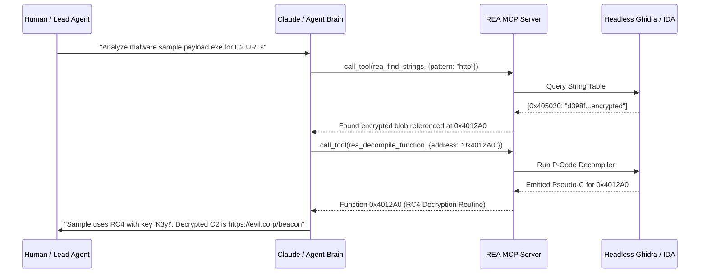

# The AI Reverse Engineering Frontier (2024–2026)

## Overview
Between 2024 and 2026, software reverse engineering underwent a structural paradigm shift. Where researchers previously spent hundreds of hours manually tracing cross-references, renaming hex offsets, and reverse-engineering complex state machines, modern LLM architectures paired with the **Model Context Protocol (MCP)** enable autonomous agents to analyze and deconstruct compiled software in minutes.

---

## 1. The Core AI Paradigms in Reverse Engineering

### 1.1 Neural Decompilation (e.g., `alpa-projects/llm4decompile`)
Traditional decompilers utilize static heuristic algorithms to invert compiler pipelines. However, compiler optimization passes (`-O2`, `-O3`, vectorization, inlining) are mathematically lossy—they discard identifiers, comments, and structure definitions.

**Neural Decompilation** uses deep sequence-to-sequence transformers trained on parallel corpora of unoptimized/optimized assembly and ground-truth C source code:
- Infers variable names (`int socket_fd` instead of `int iVar1`).
- Identifies standard algorithms (AES S-boxes, MD5 initializations, compression loops) via pattern recognition rather than complex graph isomorphism tests.
- Synthesizes valid, re-compilable C code directly from disassembled instructions.

### 1.2 Agentic MCP Orchestration (e.g., `morluto/rea`)
The **Model Context Protocol (MCP)** creates an open, standardized bridge between Large Language Models (Claude, GPT, Gemini) and local binary analysis engines (Ghidra, IDA Pro, Hopper, Radare2).



---

## 2. Key Prompt Architectures for Binary Triage

When using AI coding assistants or autonomous subagents to investigate binaries:

### Function Summarization & Renaming Prompt
```text
You are an expert binary reverse engineer. Analyze the following decompiled pseudo-C function extracted from Ghidra/Hex-Rays:
<FUNCTION_DECOMPILATION>
{{decompiler_output}}
</FUNCTION_DECOMPILATION>

Perform the following tasks:
1. Explain the high-level intent of the function in 2 sentences.
2. Identify all cryptographic constants, Windows API calls, or socket operations.
3. Provide a mapping of cryptic variable names to meaningful semantic names (e.g., `local_1c` -> `bytes_received`).
4. Output a cleaned, idiomatic C representation of the function.
```

---

## 3. Future Trajectory (2026 and Beyond)
- **Zero-Shot Vulnerability Discovery**: Autonomous multi-agent teams fuzzing, symbolically executing, and decompiling software simultaneously.
- **Dynamic Binary Memory Reconstruction**: Neural models reading live memory snapshots and auto-generating accurate C++ header definitions.
- **Automated Anti-Analysis Bypass**: Agents detecting anti-debugging and anti-VM tricks in assembly and generating custom Frida hooks on the fly.
