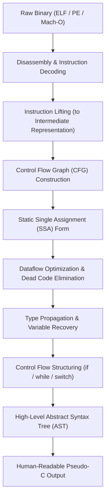

# The 30-Year Evolution of Software Decompilation (1990–2026)

## Executive Summary
Software decompilation is the process of translating low-level machine code (raw byte opcodes) back into human-readable high-level programming language representations (primarily C/C++ or pseudo-code). Over the past three decades, decompilation has evolved across distinct architectural epochs:

1. **1990–1999: Raw Disassembly & Ring 0 Interception** (GDB, SoftICE, IDA 1.0)
2. **2000–2009: The Heuristic & Flow Graph Boom** (OllyDbg, Boomerang, Hex-Rays 2007)
3. **2010–2018: Intermediate Representations & Symbolic Analysis** (Capstone, Unicorn, Triton, angr, Binary Ninja)
4. **2019–2023: The NSA Ghidra Revolution & Open SRE** (Ghidra, P-Code, Sleigh, Rizin, Cutter)
5. **2024–2026: Autonomous Multi-Agent & Neural Decompilation** (LLM4Decompile, REA MCP Server, Gepetto)

---

## 1. Classical Decompilation Pipeline

A modern industrial decompiler (such as NSA Ghidra or Hex-Rays) executes a multi-stage pipeline:

### Key Stages Explained
- **Instruction Lifting**: Converting diverse CPU opcodes (x86, ARM, MIPS) into an architecture-neutral Intermediate Representation (IR).
  - *Ghidra*: Uses **P-Code** via **Sleigh**.
  - *IDA Pro*: Uses **Microcode**.
  - *Binary Ninja*: Uses tiered **LLIL / MLIL / HLIL**.
  - *Rizin*: Uses **RzIL / ESIL**.
- **Static Single Assignment (SSA)**: Every variable is assigned exactly once. This allows φ-nodes (phi nodes) to resolve branch merges and enables standard compiler optimization algorithms to run in reverse.
- **Control Flow Structuring**: Algorithms like the Noam/Cifuentes schema restructure raw jump graphs into structured high-level constructs (`while`, `for`, `if/else`, `switch`).

---

## 2. Comparison of Intermediate Representations

| Metric | Ghidra P-Code | Hex-Rays Microcode | Binary Ninja MLIL | Rizin RzIL |
| :--- | :--- | :--- | :--- | :--- |
| **Origin** | NSA Research | Hex-Rays (Ilfak Guilfanov) | Vector 35 | Rizin Project |
| **Representation** | Micro-operations (varnodes) | High-level SSA micro-ops | Tiered SSA IR | Virtual instruction strings |
| **Definition Language** | Sleigh (`.slaspec`) | Proprietary C++ engine | Python & C++ core | C AST |
| **Extensibility** | Open specification | Closed commercial SDK | Open API & Plugin System | Open Source LGPL |
| **Performance** | High (Java JNI to C++) | Ultra-fast native C++ | Fast native C++ | Fast native C |

---

## 3. The Modern Neural & Autonomous Era (2024–2026)

### Limitations of Classical Rule-Based Decompilers
- **Stripped Variable Names**: Compilers discard local variable identifiers (`int local_14` instead of `int buffer_len`).
- **Inlined Functions**: Optimizing compilers (`gcc -O3`) inline functions, unroll loops, and vectorize logic, destroying function boundaries.
- **Stripped Struct Layouts**: Memory offsets (`*(int*)(eax + 0x18)`) require laborious manual struct reconstruction.

### Neural Decompilation (LLM4Decompile & REA)
Large Language Models trained on massive corpus of matched assembly-source pairs invert compiler transformations probabilistically:
1. **Semantic Recovery**: Accurately inferring domain variables (`auth_token`, `socket_fd`, `cipher_ctx`) based on API call context.
2. **Autonomous Tool Use via Model Context Protocol (MCP)**: Tools like `morluto/rea` link LLMs directly to headless Ghidra instances, allowing the AI to query xrefs, rename symbols, patch memory, and confirm decompilation correctness iteratively.
