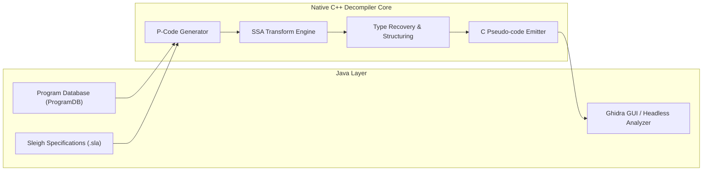

# NSA Ghidra Architecture & Ecosystem Deep Dive

## Introduction
At the RSA Conference in March 2019, the United States National Security Agency (NSA) officially declassified and open-sourced **Ghidra** under the Apache 2.0 license. Prior to this release, enterprise-grade decompilation was dominated by Hex-Rays' proprietary IDA Pro, which cost thousands of dollars per license seat. Ghidra disrupted the industry by offering:
- Multi-architecture decompilation out of the box (x86, x64, ARM, AArch64, MIPS, PowerPC, SPARC, RISC-V, 6502, Z80).
- Sleigh, a formal processor specification language.
- A multi-user collaborative server enabling real-time simultaneous reverse engineering.
- Complete open-source transparency.

---

## 1. Internal Architecture

Ghidra is split into two primary layers:
1. **The Application & GUI Layer (Java)**:
   - Plugin-based architecture managed via `PluginTool`.
   - Program Database (`ProgramDB`) managing symbol tables, address spaces, comments, and references.
   - Headless Analyzer (`analyzeHeadless`) for mass automated batch decompilation in CI/CD pipelines.

2. **The Decompiler Engine (Native C++)**:
   - The decompiler is written in portable C++ and communicated via JNI / subprocess pipes.
   - Converts raw machine instructions into **P-Code** varnodes.
   - Runs data-flow analysis, dead code removal, constant propagation, and emits structured pseudo-C.



---

## 2. Sleigh: The Processor Specification Language

One of Ghidra's greatest architectural triumphs is **Sleigh**. Instead of hardcoding disassemblers in C++ for each architecture, Ghidra models CPU architectures using `.slaspec` definition files.

A Sleigh definition specifies:
1. **Registers & Address Spaces**: Word size, endianness, bit registers (`EAX`, `RAX`, `X0`).
2. **Instruction Disassembly Patterns**: Bit patterns matching opcodes.
3. **P-Code Semantics**: What the instruction actually does in abstract register transfers.

### Example Sleigh Definition:
```sleigh
:ADD reg1, reg2 is op=0x01 & reg1 & reg2 {
    reg1 = reg1 + reg2;
}
```
This enables the decompiler to immediately support any exotic or proprietary microprocessor simply by compiling a `.sla` file.

---

## 3. Comparison: Ghidra vs. Modern Counterparts

| Dimension | NSA Ghidra | IDA Pro (Hex-Rays) | Rizin + Cutter | Binary Ninja |
| :--- | :--- | :--- | :--- | :--- |
| **Price** | Free (Apache 2.0) | \$2,000–\$5,000+ / seat | Free (GPL/LGPL) | \$300–\$1,200+ |
| **Startup / Speed** | Moderate (JVM memory) | Ultra-fast native | Ultra-fast native | Extremely fast |
| **Decompiler Quality** | Excellent, SSA-based | World-class, highly polished | Ghidra native / RzIL | Outstanding (HLIL) |
| **Multi-User Collab** | Built-in Server | Third-party / Team Server | Git / manual export | Enterprise Server |
| **Automation Language** | Python 3 (via PyGhidra) & Java | Python (IDAPython) & C++ | Python, Rust, C | Python 3 & C++ |

---

## 4. Modern Forks & Extended Ecosystem

- **Cutter (`rizinorg/cutter`)**: Packages Ghidra's decompiler in a high-speed native Qt interface powered by Rizin without requiring the heavy Java desktop environment.
- **PyGhidra**: Official Python 3 bindings bridging CPython directly into Ghidra's JVM memory space.
- **REA (`morluto/rea`)**: AI Model Context Protocol orchestrator using headless Ghidra to automate vulnerability triage.
