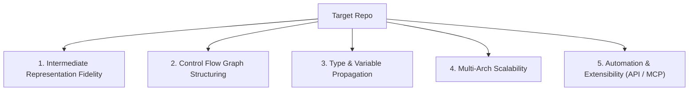

# Decompiler & Binary Analysis Benchmarking Prompt

> **Purpose**: A standardized evaluation prompt to assess and score new decompilation tools, plugins, or AI models when evaluating them for inclusion in the timeline.

---

## Autonomous Evaluation Protocol

Evaluate the target repository: `{{REPO_NAME}}` (`{{REPO_URL}}`) across five core technical pillars:



### Pillar Scoring rubric (1 to 10 points each):

1. **IR Fidelity & Formalism (Weight: 20%)**:
   - Does it lift to a well-defined intermediate language (e.g., P-Code, MLIL, LLVM IR, RzIL)?
   - Does it support Static Single Assignment (SSA) form with explicit $\phi$ (phi) functions?

2. **Control Flow Graph (CFG) Structuring (Weight: 25%)**:
   - How does it handle obfuscated loops, switch jump tables, and irreducible control flow?
   - Does it recover structured `do-while`, `while`, `for`, and `if-else` blocks without resorting to unstructured `goto` cascades?

3. **Type & Variable Recovery (Weight: 20%)**:
   - Does it infer struct member offsets (`entity->health` vs `*(int*)(reg + 0x20)`)?
   - Can it propagate types across function call boundaries?

4. **Multi-Architecture Scalability (Weight: 15%)**:
   - Does it support x86, x86_64, ARM, AArch64, MIPS, RISC-V?
   - Can new processor modules be added via specification files (like Sleigh)?

5. **Ecosystem & AI Interoperability (Weight: 20%)**:
   - Does it expose a headless CLI or Python/C++ API?
   - Does it provide Model Context Protocol (MCP) or JSON-RPC endpoints for autonomous agent integration?

---

## Output Template

```markdown
### Benchmark Report: [Tool Name]
- **Repository**: [URL]
- **Composite Score**: [Score]/50
- **Primary IR**: [P-Code / Microcode / MLIL / AST]
- **Key Advantage**: [What makes it unique]
- **Primary Bottleneck**: [Current architectural limitations]
- **Inclusion Recommendation**: [Must-Include / Fast-Follow / Watchlist]
```
