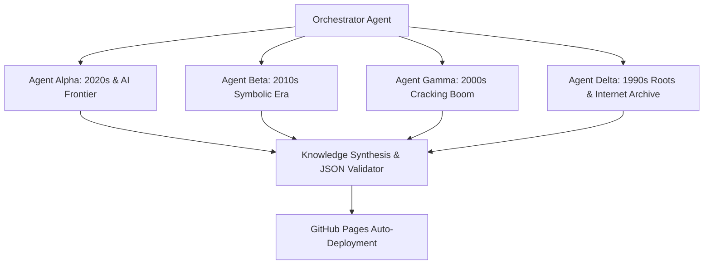

# Subagent Research Orchestrator Prompt

> **Purpose**: Use this prompt when orchestrating multiple specialized subagents to divide-and-conquer historical research across 30+ years of software history, archives, and GitHub trends.

---

## Architecture of the Multi-Agent Research Swarm

---

## Subagent Role Definitions

### 1. Agent Alpha (AI & Modern Decompilers: 2020–2026)
- **Target Query**: `AI reverse engineering, Model Context Protocol decompiler, LLM assembly translation, Ghidra AI plugins`.
- **Primary Hubs**: GitHub Trending, Hugging Face Papers, Hacker News, arXiv CS.CR.
- **Key Deliverable**: Identify the top 5 emerging repositories that merge LLMs with static binary analysis.

### 2. Agent Beta (Symbolic Execution & Dynamic Instrumentation: 2010–2019)
- **Target Query**: `angr, Triton, Capstone, Unicorn, Keystone, Frida, Radare2, Cutter, NSA Ghidra declassification`.
- **Primary Hubs**: DARPA Cyber Grand Challenge archives, REcon conference proceedings, GitHub release histories.
- **Key Deliverable**: Benchmark the transition from raw disassemblers to modular C/Python micro-engines.

### 3. Agent Gamma (The Golden Age of 32-bit Disassembly: 2000–2009)
- **Target Query**: `OllyDbg, IDA Pro Hex-Rays 2007, Boomerang Decompiler, Metasploit, Wireshark/Ethereal`.
- **Primary Hubs**: Woodmann's reverse engineering forums, old OpenRCE archives, Phrack Magazine, DEF CON archives.
- **Key Deliverable**: Document the emergence of GUI debugging, FLIRT signatures, and first-generation C decompilers.

### 4. Agent Delta (The Dawn of Reversing & Ring 0: 1985–1999)
- **Target Query**: `NuMega SoftICE, GNU Binutils BFD, GDB, MS-DOS DEBUG.EXE, IDA 1.0 MS-DOS, Linux Kernel 0.01`.
- **Primary Hubs**: Internet Archive (archive.org), FSF archives, early Usenet newsgroups (`comp.os.msdos.programmer`, `alt.hackers`).
- **Key Deliverable**: Verify exact initial release years, author origins, and initial license terms.

---

## Synthesis Guidelines
When collecting subagent findings:
1. Merge outputs into `data/timeline.json`.
2. Ensure no duplicates exist.
3. Validate all GitHub repository URLs and archive.org mirror permalinks.
